<!-- 3D Cosmic Portfolio Banner -->

  

<!-- Animated Typing Subtitle -->

<!-- Social / Contact Badges -->

  
  
  
  

<!-- Profile Metrics -->

  
  
  

---

### 👨‍💻 About Me

- 🎓 **Education:** MCA Student at **Lovely Professional University**
- 💻 **Core Focus:** Developing responsive, modern web applications with **React, JavaScript & CSS** connected to **PHP, Laravel & MySQL**
- 🧠 **Problem Solving:** Actively practicing Data Structures & Algorithms on **LeetCode**
- 🌱 **Currently Learning:** Advanced **React patterns**, **Laravel REST APIs**, and backend architecture
- 💬 **Ask me about:** HTML, CSS, JavaScript, React, PHP, MySQL, Web Deployment & Git

---

### 🛠️ Tech Stack

| Category | Technologies |
| :--- | :--- |
| **Languages** |  |
| **Frontend** |  |
| **Backend** |  |
| **Database** |  |
| **Tools & Platforms** |  |

---

### 🚀 Featured Projects

<table width="100%">
<tr>
<td width="50%" valign="top">

### 📚 StudySphere Learning Platform
A responsive educational platform enabling students to access, view, and download subject-wise notes, take tests, and earn digital certificates.

- **Stack:** HTML5, JavaScript, Bootstrap, PHP, MySQL
- • Developed a responsive platform enabling students to access, view, and download subject-wise notes, take tests, and earn digital certificates.
- • Created a Test module with timed quizzes, auto-scoring, and performance tracking.
- • Added leaderboard functionality and YouTube video links to support learning.
- - 🔗 **[Explore Repository →](https://github.com/sagnik81599/studysphere)**

</td>
<td width="50%" valign="top">

### 🌐 [Personal Portfolio Website](https://github.com/sagnik81599/My-Portfolio)
A modern personal developer portfolio showcasing projects, experience, and contact details with dynamic typing and smooth 3D animations.

- **Stack:** HTML5, CSS3, JavaScript
- • Animated role introduction with interactive 3D cosmic background.
- • Interactive project showcase, skills breakdown, and downloadable CV.
- • Fully mobile-responsive layout and dark mode support.
- 🔗 **[Explore Repository →](https://github.com/sagnik81599/My-Portfolio)**

</td>
</tr>
</table>

---

### 📊 Contributions & Problem Solving

<!-- GitHub Streak & Total Contributions Stats -->

  

<!-- LeetCode Card -->

  

<!-- Contribution Snake Animation -->
<picture>
  <source media="(prefers-color-scheme: dark)" srcset="https://raw.githubusercontent.com/sagnik81599/sagnik81599/output/github-snake-dark.svg" />
  <source media="(prefers-color-scheme: light)" srcset="https://raw.githubusercontent.com/sagnik81599/sagnik81599/output/github-snake.svg" />
  
</picture>

---

  ⭐ Designed with passion by <a href="https://github.com/sagnik81599">Sagnik Saha</a>

